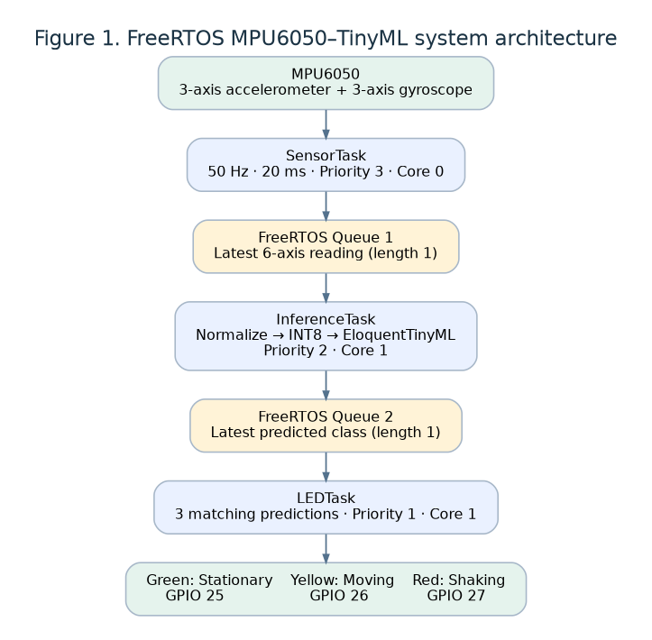
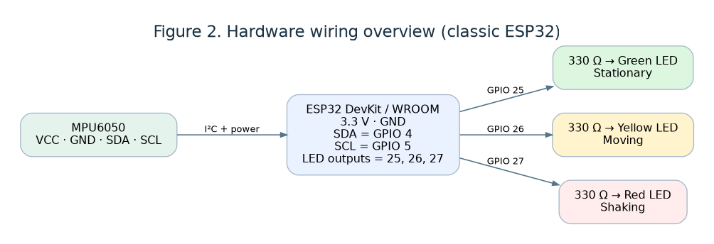

# Simple MPU6050 Gesture Recognition with FreeRTOS and TinyML

**Platform:** Classic dual-core ESP32 · **Sensor:** MPU6050 · **Frameworks:** FreeRTOS and EloquentTinyML · **Duration:** Approximately 2–3 hours

## 1. Objective

Extend the existing MPU6050 + EloquentTinyML + 3-LED application into **three FreeRTOS tasks**. Students will learn periodic sampling, queues, task priorities, and real-time gesture classification while preserving the original trained **INT8 model**.

At the end of this lab, students should be able to (1) create three tasks, (2) exchange data through queues, (3) classify **stationary / moving / shaking**, and (4) measure inference time.

## 2. System architecture



**Figure 1.** The sensor task samples the MPU6050 every 20 ms. The inference task consumes six-axis data and runs the neural network. The LED task displays the stable class after three consecutive matching predictions. Both queues hold only the *latest* record, preventing an outdated backlog.

## 3. Hardware wiring



**Figure 2.** Use resistors in series with the LEDs. Connect the MPU6050 to 3.3 V, GND, GPIO 4 (SDA), and GPIO 5 (SCL). Verify the module's voltage requirements. Set AD0 low for the expected I²C address `0x68`.

| Component | ESP32 pin | Note |
|---|---|---|
| MPU6050 SDA | GPIO 4 | I²C data |
| MPU6050 SCL | GPIO 5 | I²C clock |
| MPU6050 VCC | 3.3 V | Confirm module rating |
| MPU6050 GND | GND | Common ground |
| Green LED | GPIO 25 | Stationary; use series 330 Ω resistor |
| Yellow LED | GPIO 26 | Moving; use series 330 Ω resistor |
| Red LED | GPIO 27 | Shaking; use series 330 Ω resistor |

## 4. Software and required files

Use **Arduino IDE** with the ESP32 board package, matching **EloquentTinyML 3.x** and `tflm_esp32` runtime compatible with the original project. Select a **classic dual-core ESP32 DevKit / WROOM**. Set Serial Monitor to **115200 baud**.

Put these files into **the same Arduino sketch folder**:

```text
MPU6050_Eloquent_FreeRTOS_3LED/
├── MPU6050_Eloquent_FreeRTOS_3LED.ino
├── MPU6050Simple.h          ← from original project
├── MPU6050Simple.cpp        ← from original project
└── model.h                  ← original trained INT8 model
```

**Important:** The included `.ino` depends on the original helper files and trained `model.h`; those are **not reproduced** in this package. Do not substitute arbitrary model weights.

## 5. Tasks and communication

| FreeRTOS task | Priority | Core | Role |
|---|---:|---:|---|
| `SensorTask` | 3 | 0 | Read six MPU6050 features every 20 ms |
| `InferenceTask` | 2 | 1 | Normalize, quantize, predict class |
| `LEDTask` | 1 | 1 | Stabilize predictions and control LEDs |

The program uses:

```cpp
sensorQueue = xQueueCreate(1, sizeof(SensorFrame));
predictionQueue = xQueueCreate(1, sizeof(PredictionFrame));
```

A **length-one queue** uses `xQueueOverwrite()` to keep the newest data. `xQueueReceive()` allows a consumer task to wait rather than repeatedly polling.

**Task ownership:** Only `SensorTask` accesses the I²C sensor; only `InferenceTask` calls `tf.predict()`; only `LEDTask` writes the LEDs.

## 6. Procedure

1. First compile/run the **original sequential** `MPU6050_Eloquent_3LED.ino` with the correct `model.h`, confirming sensor measurements and classes.
2. Open `MPU6050_Eloquent_FreeRTOS_3LED.ino` from this package in Arduino IDE and copy in the required helper/model files.
3. Wire the MPU6050 and the three LEDs as in Figure 2. Select the correct ESP32 board and serial port.
4. Compile and upload. Open Serial Monitor at **115200 baud**.
5. Keep the sensor still, move it gently, then shake it. Observe the predicted class and LED color.
6. Record inference time, the elapsed age of each sensor record, and any sampling warnings.
7. Change `SAMPLE_MS` from `20` to `50` and repeat; then restore it.
8. Change `STABLE_COUNT` from `3` to `1` and compare the LED response; then restore it.

## 7. Key code excerpts

**Periodic acquisition:**

```cpp
TickType_t last = xTaskGetTickCount();
TickType_t period = pdMS_TO_TICKS(SAMPLE_MS);
for (;;) {
    vTaskDelayUntil(&last, period);
    SensorFrame frame = {};
    if (mpu.readFeatures(frame.features)) {
        frame.stampUs = micros();
        xQueueOverwrite(sensorQueue, &frame);
    }
}
```

**Inference task:**

```cpp
SensorFrame sensor;
for (;;) {
    if (xQueueReceive(sensorQueue, &sensor, portMAX_DELAY) == pdTRUE) {
        int8_t input[6];
        mpu6050_prepare_input(sensor.features, input);
        tf.predict(input);  // See full sketch for error checking
    }
}
```

**LED stabilization:** The full `LEDTask` changes the displayed class only after `STABLE_COUNT` consecutive predictions agree.

## 8. Expected output

Illustrative Serial Monitor lines (actual timings and classifications vary):

```text
MPU6050 + EloquentTinyML INT8 + FreeRTOS
seq=101 pred=stationary LED=stationary inference=... us
seq=112 pred=moving LED=moving inference=... us
seq=125 pred=shaking LED=shaking inference=... us
```

The classes map to **stationary → green**, **moving → yellow**, and **shaking → red**.

## 9. Experiments and results

| Test | `SAMPLE_MS` | `STABLE_COUNT` | Observed class | LED | Inference (µs) | Notes |
|---|---:|---:|---|---|---:|---|
| Still | 20 | 3 | | | | |
| Move | 20 | 3 | | | | |
| Shake | 20 | 3 | | | | |
| Repeat | 50 | 3 | | | | |
| Repeat | 20 | 1 | | | | |

Compare with the original sequential sketch: Does the sensor sampling remain responsive while inference runs? Do LED changes become noisier when `STABLE_COUNT = 1`? If inference exceeds 20 ms, some frames may be replaced before processing.
<!---
## 10. Checkpoint questions

1. What is the difference between a FreeRTOS task and Arduino's ordinary `loop()`?
2. Why is `vTaskDelayUntil()` useful for a 20 ms sampling interval?
3. Why are two queues used?
4. Why should only one task own the EloquentTinyML model object?
5. What does `xQueueOverwrite()` do when inference runs slowly?
6. How do task priority and CPU-core affinity differ?
7. Why use three consecutive predictions to update an LED?
8. What measurements would demonstrate improved responsiveness?

## 11. Submission

Submit the modified `.ino` sketch, one photograph of the hardware, the Serial Monitor output for all three gestures, the completed results table, and a short comparison with the sequential implementation.

## 12. Notes and limitations

This is a **teaching example**, not a hard real-time guarantee. The sketch targets a **classic dual-core ESP32**; core pinning and GPIOs may need changes on other boards. It depends on the same EloquentTinyML/runtime API as the original example and has **not been hardware-tested** here. Gesture-model quality depends on the original training data; validate it using real MPU6050 measurements.

### Reference

Original project: [MPU6050_Eloquent_3LED.ino](https://github.com/komsan-k/IO-engineering/blob/main/week-5-mini-project/project-2/MPU6050_Eloquent_3LED.ino)
--->
